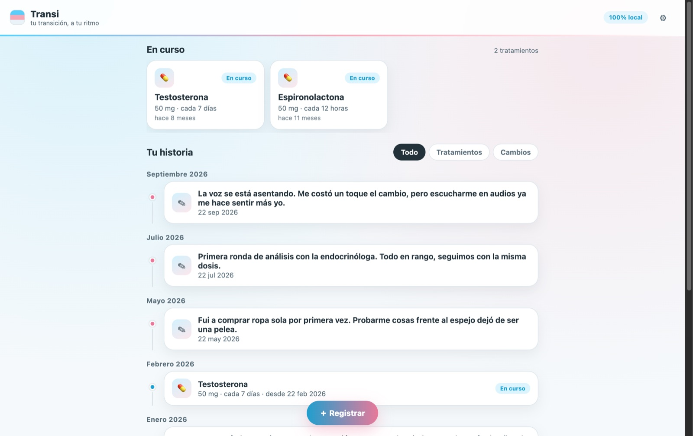
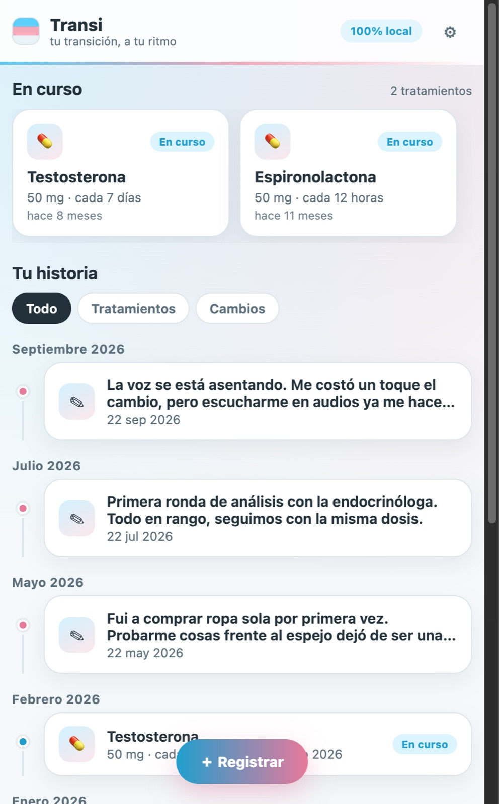
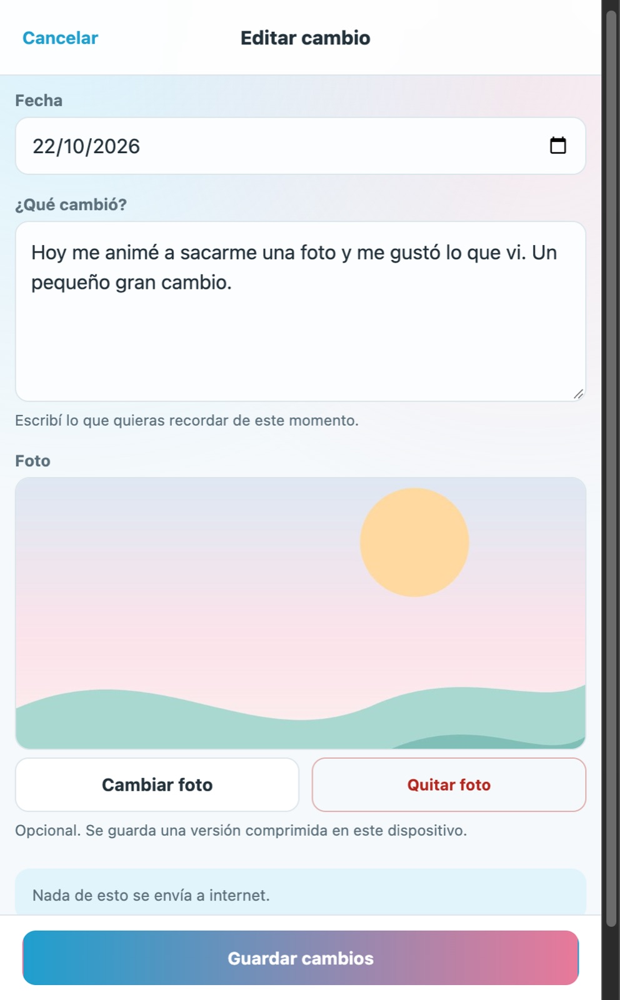
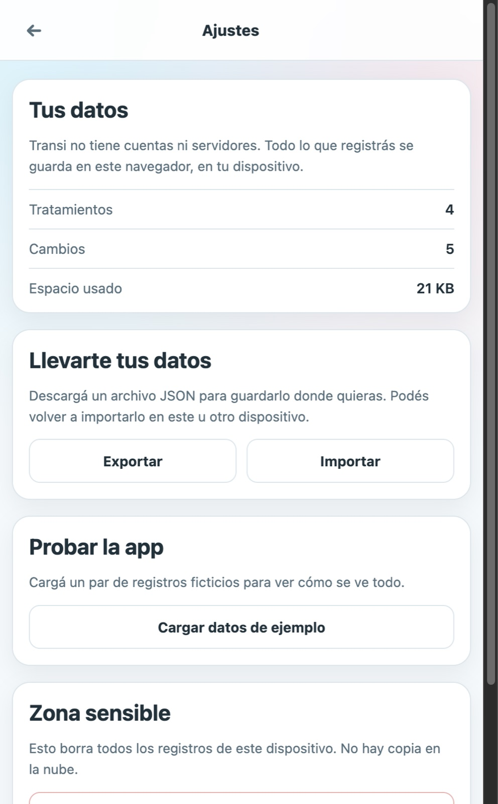
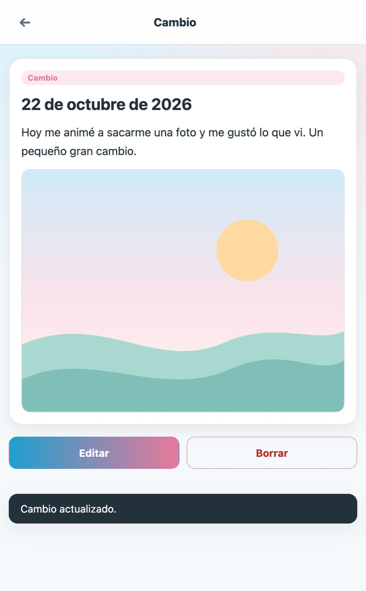
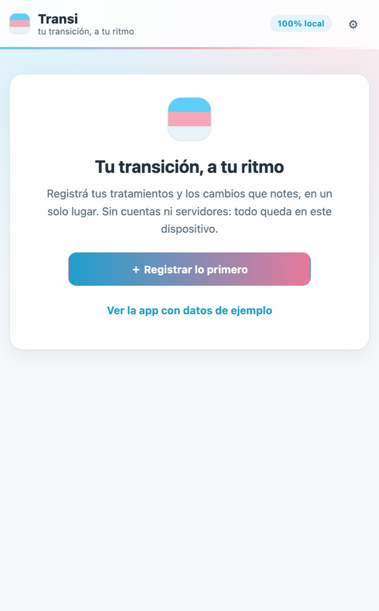

# Transi

**Registrá tus tratamientos y tus cambios en un solo lugar. Simple, privado y sin cuentas.**

Transi es una app para personas trans que quieren llevar un registro de sus
tratamientos de salud y documentar cómo van cambiando en el tiempo. Nació como
un proyecto real y quedó como pieza de portafolio: una app chica, terminada y
con una decisión de producto clara — **tus datos son tuyos y no salen de tu
dispositivo**.

> **Demo:** `https://TU-USUARIO.github.io/transi/`
> _(reemplazá el link cuando actives GitHub Pages; el workflow ya está incluido)_

[](docs/capturas/inicio-desktop.jpg)

## La idea

Un tratamiento oncológico, hormonal o de cualquier tipo genera fechas, dosis y
profesionales que se pierden entre mensajes, recetas y memoria. Y los cambios
—físicos, emocionales, los que sean— tampoco suelen quedar registrados en ningún
lado.

Transi resuelve dos cosas y nada más:

1. **Qué estás tomando** y desde cuándo.
2. **Qué cambió** y cómo te sentís al respecto.

Todo en una línea de tiempo, sin planillas ni formularios infinitos.

## Qué podés hacer

- **Línea de tiempo** con tratamientos y cambios, ordenada por fecha y agrupada
  por mes. Filtros por tipo.
- **Tratamientos en curso** siempre visibles arriba, con dosis, frecuencia y
  hace cuánto empezaste.
- **Registrar y editar tratamientos**: medicamento, dosis, frecuencia, fechas y
  profesional (opcional).
- **Registrar cambios** con una nota y una foto opcional. La foto se comprime en
  el navegador antes de guardarse.
- **Exportar e importar** todo como un archivo JSON.
- **Datos de ejemplo** en un clic para ver la app funcionando sin cargar nada.
- **Borrar todo** sin dejar rastros.

## Qué quedó afuera (a propósito)

La versión anterior de Transi tenía backend en Go, app Flutter, app Tauri,
cuentas, respaldos en la nube, recordatorios, notas de voz y varios
medicamentos por tratamiento. Para el portafolio recorté todo lo que no se
puede mostrar en 30 segundos:

| Quedó afuera | Por qué |
|---|---|
| Cuentas y servidor | El valor está en los datos, no en el login. Sin servidor, la privacidad es real y no hay nada que mantener. |
| Respaldos en la nube | Se reemplazaron por exportar/importar un JSON. |
| Recordatorios y audio | Funciones útiles, pero no hacen falta para entender el producto. |
| Flutter + Tauri | Una sola app web corre en cualquier lado y se prueba con un link. |

La versión completa sigue disponible en el tag
[`v1-completa`](https://github.com/TU-USUARIO/transi/tree/v1-completa):
`git checkout v1-completa`.

## Cómo está hecha

- **TypeScript puro + Vite**, sin frameworks de UI. 2.800 líneas entre app,
  estilos y pruebas.
- **localStorage** como única base de datos (`transi.datos`). No hay API, no
  hay cookies, no hay analytics.
- **Fotos comprimidas** con `<canvas>` a un máximo de 1200 px y JPEG 0.78.
- **Rutas por hash** (`#/detalle/cambio/123`), así funciona en cualquier hosting
  estático y el botón Atrás hace lo que esperás.
- **20 pruebas** con Vitest sobre el modelo, la persistencia, las fechas y las
  rutas.

```
.
├── src/
│   ├── main.ts            # router y arranque
│   ├── rutas.ts           # rutas por hash
│   ├── modelo.ts          # entidades, reglas, demo y línea de tiempo
│   ├── almacen.ts         # localStorage + validación de respaldos
│   ├── formato.ts         # fechas sin zonas horarias
│   ├── imagen.ts          # compresión de fotos
│   ├── ui.ts              # helpers de DOM
│   ├── styles.css
│   └── vistas/            # inicio, registrar, formularios, detalles, ajustes
├── pruebas/               # Vitest
├── public/                # ícono
└── docs/capturas/         # capturas del README
```

### Modelo de datos

```ts
type Tratamiento = {
  id: string;
  nombre: string;
  dosis: string;
  frecuencia: string;
  inicio: string;              // AAAA-MM-DD
  fin: string | null;
  profesional: string | null;
};

type Cambio = {
  id: string;
  fecha: string;               // AAAA-MM-DD
  descripcion: string;
  foto: string | null;         // data URL comprimida
};
```

El estado *en curso* no se guarda: se deriva de la fecha de fin. Una sola fuente
de verdad, menos cosas que puedan quedar inconsistentes.

## Probarla

```sh
pnpm install
pnpm dev
```

Abrí `http://localhost:5173` y elegí **“Ver la app con datos de ejemplo”**.

```sh
pnpm test     # 20 pruebas
pnpm build    # dist/ listo para publicar
```

### Publicar la demo

El repositorio incluye `.github/workflows/paginas.yml`. En GitHub:

1. **Settings → Pages → Source: GitHub Actions**.
2. Hacé push a `main`.
3. Copiá la URL publicada en la primera línea de este README.

## Capturas

| Inicio | Registrar un cambio | Ajustes |
|---|---|---|
|  |  |  |

| Detalle de un cambio | Primer arranque |
|---|---|
|  |  |

## Decisiones que vale la pena contar

- **Sin backend como feature, no como limitación.** Al no haber servidor no hay
  base de datos que filtrar, ni sesiones que roten, ni respaldos que se filtren.
  El costo es que los datos viven en un navegador; por eso existen exportar e
  importar.
- **localStorage en vez de IndexedDB.** El modelo entra en unos pocos KB. Las
  fotos se comprimen para que decenas de registros sigan entrando. Si el
  navegador se queda sin espacio, la app avisa en vez de fallar en silencio.
- **TypeScript puro.** Para seis pantallas, un framework agrega más ceremonia
  que ayuda. El router son 40 líneas y cada vista devuelve un nodo del DOM.
- **Datos de ejemplo, no un video.** Quien abre el link puede tocar la app en
  diez segundos, sin registrarse ni cargar nada.

## Privacidad

Transi no envía datos a ningún servidor. No usa cookies, analytics ni fuentes
externas. Todo lo que cargás se guarda en el `localStorage` de tu navegador y
podés borrarlo desde **Ajustes → Borrar todos mis datos**.

Esto es una app de registro personal: **no reemplaza un historial clínico ni es
consejo médico**.

---

Hecho con foco en lo simple. Si te sirve la idea, usala, cambiá los textos y
adaptala a lo que necesites.
