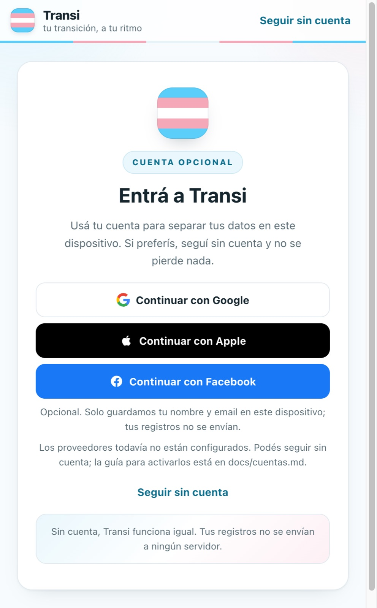
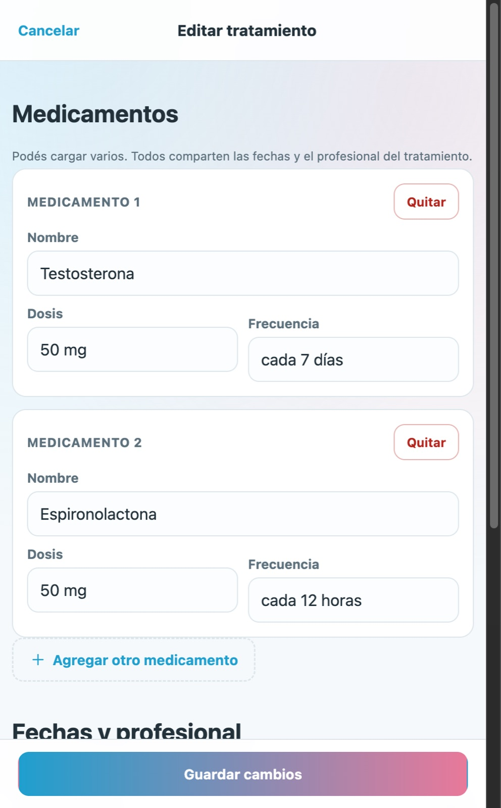

# Transi

**Track your treatments and your changes in one place. Simple, private and with no server.**

Transi is an app for trans people who want to keep a record of their health
treatments and document how they change over time. It started as a real project
and stayed as a portfolio piece: a small, finished app with a clear product
decision — **your data is yours and never leaves your device**.

> **Demo:** `https://paolobastida.github.io/transi-app/`
> _(GitHub Pages updates automatically on push to `main`)_

[](docs/capturas/inicio-desktop.jpg)

## The idea

An oncological, hormonal or any other treatment generates dates, doses and
professionals that get lost among messages, prescriptions and memory. And
changes — physical, emotional, whatever they are — are rarely recorded anywhere
either.

Transi solves two things and nothing else:

1. **What you are taking** and since when.
2. **What changed** and how you feel about it.

All in a timeline, without spreadsheets or endless forms.

## What you can do

- **Timeline** with treatments and changes, ordered by date and grouped by
  month. Filters by type.
- **Treatments in progress** always visible at the top, with dose, frequency
  and how long ago you started.
- **Register and edit treatments** with **one or several medications**. They
  all share dates and professional, and each has its own dose and frequency.
- **Reminders per medication**: you enter the times (e.g. 08:00 and 20:00) and
  Transi notifies you at dosing time. In the native **macOS and iOS** apps
  they are scheduled in the system and ring **even with the app closed**; in
  the browser they work while it is open. They don't repeat during the day.
  Today's ones appear on **Home**, ordered by time with the next one
  highlighted; if two medications share a time, a single notice is shown. If
  permissions are missing, Home offers to enable them without leaving the
  screen.
- **Register changes** with a note, an optional photo and a **voice note** (up
  to 60 seconds). The photo is compressed in the browser and the voice is
  recorded at 32 kbps, so dozens of records still fit without trouble.
- **Export and import** everything as a JSON file.
- **Sample data** in one click to see the app working without entering
  anything.
- **Delete everything** without leaving traces.
- **Install it as an app (PWA)** on Android, iPhone/iPad or desktop. It opens
  without the browser bar and keeps working offline.
- **Built-in help** in plain language: first steps, what a treatment or a
  change is, privacy, backups, reminders and optional accounts.

## What was left out on purpose

The previous version of Transi had a Go backend, a Flutter app, a Tauri app,
accounts, cloud backups and reminders. For the portfolio I cut everything that
can't be shown in 30 seconds:

| Left out | Why |
|---|---|
| Server | The value is in the data, not in the login. Without a server there is no database to leak, no sessions to rotate, no backups to leak. |
| Mandatory accounts | The account is **optional** and doesn't drive the product: without an account everything works the same. |
| Cloud backups | Replaced by exporting/importing a JSON. |
| Notices with the app closed in the browser | The native macOS app schedules them in the system (`UNUserNotificationCenter`). In the browser, ringing with the app closed would require push and a server. |
| Flutter + Tauri | A single web app runs anywhere and is tested with a link. |

## Try it on iPhone (native iOS)

You need macOS with Xcode and XcodeGen (`brew install xcodegen`). To build for
the iPhone 16 simulator:

```sh
./ios/build.sh 'platform=iOS Simulator,name=iPhone 16'
open ios/Transi.xcodeproj
```

To install it on a connected iPhone, open the project in Xcode, choose your
team in **Signing & Capabilities** and run the `Transi` scheme. The first time
you enable reminders, accept the notification permission. Transi's notices are
local to the device: they work without internet and with the app closed, but
they don't sync to other devices. Transi's data stays on the device.

The full version is still available at the tag
[`v1-completa`](https://github.com/TU-USUARIO/transi/tree/v1-completa):
`git checkout v1-completa`.

## The account is optional (and doesn't drive the product)

You can use Transi **without an account**, as always. But if you want, you can
sign in with **email** (works without configuring anything), or with **Google,
Apple or Facebook** if you configure their credentials. Social buttons appear
only when they are ready: if a Client ID is missing, a button that doesn't
work isn't shown.

What it does and what it **doesn't** do:

| | |
|---|---|
| **Yes** | Separates your data by account **on this device**: each account has its own space (`transi.datos.<provider>:<sub>`). |
| **Yes** | On sign in, if you had records made without an account, it offers to take them with you. Nothing is deleted. |
| **No** | It doesn't sync between devices. The provider receives **nothing** of what you enter. |
| **No** | There is no server of ours. |

### How identity is validated without a server

This is where a "login with Google" usually hides a database nobody talks
about. Here there is none:

- **Google and Apple** deliver an **ID token** (JWT). The app decodes the
  payload in the browser and validates `aud` (that the token is for *this*
  app), `iss` (that it comes from Google or Apple) and `exp` (that it isn't
  expired). Without validating `aud`, a valid credential from another app could
  open a session here. That validation lives in `src/jwt.ts` and
  `src/google.ts` / `src/apple.ts`.
- **Facebook** is different: it doesn't receive a JWT, instead the JavaScript
  SDK returns the session and the app asks the Graph API for the profile.
- **The signature is not verified.** The signature is guaranteed by the
  provider's script, loaded from its own domain — there is no backend of ours
  to check it. If that bothers you, you're right: it's the cost of having no
  server, and it's the reason the **account is optional**.
- The profile is saved in `localStorage` and read only to decide which data
  space to use. Signing out deletes it.

### Configure it

The app works fully without configuring anything.

```sh
cp .env.example .env      # and fill in the variables you want to use
```

Step-by-step guide, with permissions and domains for each provider:
**[docs/accounts.md](docs/accounts.md)**.

| Variable | For | Where to get it |
|---|---|---|
| `VITE_GOOGLE_CLIENT_ID` | Google | Console → APIs and services → Credentials → OAuth client ID (type *Web application*) |
| `VITE_APPLE_CLIENT_ID` | Apple | developer.apple.com → Identifiers → Services IDs → *Sign In with Apple* |
| `VITE_APPLE_REDIRECT_URI` | Apple | The URL declared in that Service ID's *Return URLs* |
| `VITE_FACEBOOK_APP_ID` | Facebook | developers.facebook.com → My app → Settings → Basic |

In all cases you have to declare the authorized origins:
`http://localhost:5173` in development and `https://paolobastida.github.io` for
the demo. Restart `pnpm dev` afterwards: Vite reads the `VITE_*` variables on
startup.

> Both Google's consent screen and Facebook's review start in *Testing* mode:
> only the users you add can enter. For any visitor of the demo to enter, you
> have to publish the app.

### Details per provider

- **Google**: create an *OAuth client ID* of type **Web application** and add
  the authorized origins. The official button is drawn by Google Identity
  Services.
- **Apple**: requires an **Apple Developer** account (paid), a *Services ID*
  with *Sign In with Apple*, the declared *Return URL* and the HTTPS domain
  verified with the association file at
  `/.well-known/apple-developer-domain-association.txt`. **Doesn't work on
  `localhost`**: to test it you need a domain (or an HTTPS tunnel).
- **Facebook**: create an app in Meta for Developers, set it to *Live* mode
  and add the domain under **Allowed domains for the JavaScript SDK**. In
  development mode only test accounts can enter.

Apple and Facebook SDKs load **only when opening Settings**; Google loads its
script when its button is drawn. None run on the main screen or receive health
records.

## How it's made

- **Pure TypeScript + Vite**, no UI frameworks. 9,900 lines across app, styles
  and tests.
- **localStorage** as the only database (`transi.datos`). No API, no cookies,
  no analytics.
- **Compressed photos** with `<canvas>` to a maximum of 1200 px and JPEG 0.78.
- **Voice notes** with `MediaRecorder`, in MP4/Opus when the browser allows it
  (WebM as alternative), with a maximum of 60 seconds.
- **Hash routes** (`#/detalle/cambio/123`), so it works on any static host and
  the Back button does what you expect.
- **Responsive design** with a single column on mobile, grid on tablet and a
  two-column panel on desktop. Respects safe areas (notch) and uses 44 px
  touch targets.
- **Installable PWA** with manifest, icons and service worker: network-first
  for navigation (so updates arrive) and cache-first for static resources (so
  it opens offline).
- **Dose reminders**: in the native macOS app they are scheduled with
  `UNUserNotificationCenter` (`UNCalendarNotificationTrigger` daily) and ring
  with the app closed. In the browser they use `Notification` and a timer
  every 20 s while open. No server or push in any case.
- **125 tests** with Vitest over the model, persistence, dates, recorder,
  camera, routes and reminders.

```
.
├── src/
│   ├── main.ts            # router and startup
│   ├── rutas.ts           # hash routes
│   ├── modelo.ts          # entities, rules, demo and timeline
│   ├── almacen.ts         # localStorage + backup validation
│   ├── formato.ts         # dates without time zones
│   ├── imagen.ts          # photo compression
│   ├── camara.ts          # capture with the device camera
│   ├── grabadora.ts       # voice notes with MediaRecorder (max 60 s)
│   ├── recordatorios.ts   # scheduled notices + native bridge
│   ├── ciclo_vida.ts      # releases microphone and timers on navigate
│   ├── iconos.ts          # inline SVG icons
│   ├── pwa.ts             # installation and service worker
│   ├── ui.ts              # DOM helpers
│   ├── styles.css
│   └── vistas/            # home, register, forms, details, settings
├── pruebas/               # Vitest (model, storage, recorder, camera, routes, reminders)
├── public/                # icons, manifest, robots.txt and service worker
├── macos/                 # native macOS app (WKWebView + Swift)
│   ├── Transi.swift       # window, local server and menu
│   └── Recordatorios.swift # UNUserNotificationCenter (daily notices)
└── docs/capturas/         # README screenshots
```

### Scheduled reminders (macOS app)

The native container registers a `recordatorios` bridge in the `WKWebView`. The
frontend computes the pure list of notices (`recordatoriosProgramados`) and sends
it; Swift deletes the old `transi.recordatorio.*` and schedules each one with
`UNCalendarNotificationTrigger(repeats: true)`. That way macOS delivers them
even with Transi closed.

Permission is requested from a user action ("Enable notifications" in
Settings, or when saving a treatment with times). To verify without waiting
for the time:

```sh
pnpm native:build
dist-mac/Transi.app/Contents/MacOS/Transi --probar-sincronizados
```

The log shows `[recordatorios] programados N`. If macOS hasn't authorized
notifications yet, creation fails with "Notifications are not allowed": grant
permission in System Settings → Notifications → Transi.

### Data model

```ts
type Tratamiento = {
  id: string;
  medicamentos: {
    id: string;
    nombre: string;
    dosis: string;
    frecuencia: string;
    horarios: string[];         // "HH:MM" reminder, empty if none
  }[];
  inicio: string;              // YYYY-MM-DD
  fin: string | null;
  profesional: string | null;
};

type Cambio = {
  id: string;
  fecha: string;               // YYYY-MM-DD
  descripcion: string;
  foto: string | null;         // compressed data URL
  audio: string | null;        // voice note data URL
};
```

The *in progress* state isn't stored: it's derived from the end date. A single
source of truth, fewer things that can end up inconsistent.

Data from the previous version migrates on its own when opening the app: each
old treatment becomes a treatment with one medication, without losing anything.

## Try it

```sh
pnpm install
pnpm dev
```

Open `http://localhost:5173`. The first time you'll see the **entry screen**:
you can create your space with **email** or tap **"Continue without account"**
and use the app as always. If you configured Google, Apple or Facebook, their
buttons also appear. Then, on home, choose **"Try with sample data"** if you
want to browse it with content.

```sh
pnpm test     # 129 tests
pnpm build    # dist/ ready to publish
pnpm preview  # serve dist/ locally
```

Each push runs tests and build in GitHub Actions
(`.github/workflows/ci.yml`), so a broken change doesn't reach `main`.

### Native macOS app

The `macos/` folder includes a native wrapper with `WKWebView` and an embedded
local server. It doesn't use Electron or Tauri: a real `.app` is compiled with
Swift.

```sh
pnpm native:build   # compiles the frontend and assembles the app
pnpm native:open    # opens dist-mac/Transi.app
```

The app serves `dist/` on `127.0.0.1:47615` (fixed port to keep
`localStorage` between launches) and stores its data in
`~/Library/WebKit/com.transi.app`. It only accepts connections from the same
Mac.

If the typecheck fails due to in-progress changes, `pnpm native:build:fast`
packages without running `tsc`.

### Publish the demo

The repository includes `.github/workflows/paginas.yml`. On GitHub:

1. **Settings → Pages → Source: GitHub Actions**.
2. In **Settings → Secrets and variables → Actions → Variables**, add the ones
   you use: `VITE_GOOGLE_CLIENT_ID`, `VITE_APPLE_CLIENT_ID`,
   `VITE_APPLE_REDIRECT_URI` and `VITE_FACEBOOK_APP_ID`.
3. Push to `main`.
4. Copy the published URL into the first line of this README.

### Install on iPhone

1. Open **Safari** and go to `https://paolobastida.github.io/transi-app/`.
2. Tap **Share** → **Add to Home Screen**.
3. Open it from the Transi icon: it opens without the browser bar.
4. To start from scratch with real data, **don't tap "Try with sample data"**:
   choose **"Add my first record"**.

Data stays stored in Safari's storage on your iPhone. To not lose it, export a
backup from **Settings → Take your data**. Camera and microphone ask for
permission the first time. Browser reminders ring while Transi is open; for
notices with the app closed you need the native iOS or macOS app.

## Screenshots

| Entry | Home | Treatment with several medications |
|---|---|---|
|  |  |  |

| Register a change | Change detail | Settings |
|---|---|---|
|  |  |  |

## Decisions worth telling

- **No backend as a feature, not a limitation.** With no server there is no
  database to leak, no sessions to rotate, no backups to leak. The cost is that
  data lives in a browser; that's why export and import exist.
- **localStorage instead of IndexedDB.** The model fits in a few KB. Photos
  are compressed so dozens of records still fit. If the browser runs out of
  space, the app warns instead of failing silently.
- **Pure TypeScript.** For six screens, a framework adds more ceremony than
  help. The router is 40 lines and each view returns a DOM node.
- **Sample data, not a video.** Whoever opens the link can tap the app in ten
  seconds, without registering or entering anything.

## Privacy

Transi doesn't send your health records to any server. It doesn't use its own
cookies, analytics or external sources. Everything you enter is saved in your
browser's `localStorage` and you can delete the active profile's data from
**Settings → Start over**.

**Email access loads no external service**: the profile is saved only on this
device. If you sign in with Google, Apple or Facebook, the provider's SDK loads
from its domain and receives only what's needed to identify you; **never** your
treatments, changes, photos or voice notes.

The microphone is only activated when you tap **Record note** and turns off
when you stop recording or leave the screen. Recording audio requires HTTPS
(or `localhost`), a browser security restriction.

This is a personal record app: **it doesn't replace a medical record or medical
advice**.

---

Made with focus on simplicity. If the idea helps you, use it, change the texts
and adapt it to what you need.
